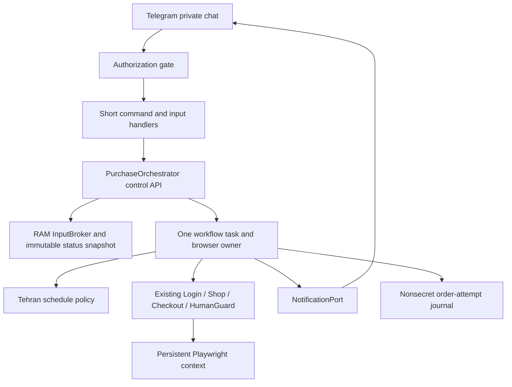

# KavirScout Telegram Integration Plan

**Implementation update — 2026-10-29:** local implementation is now available on
`feature/telegram-app`. See [implementation status](telegram-implementation-status.md)
and [operations](telegram-operations.md) for actual behavior, tests and remaining
live release gates. The planning-only restrictions below describe the original
documentation task; they do not describe the subsequent implementation session.
The owner subsequently confirmed **2 tires** for the same model/size. Current
code defaults and both examples now use two; four-tire requirements below are
historical design context, not the current target. Real Telegram command replies
are confirmed; live retailer validation remains pending. Start with the
[documentation index](README.md) and [current architecture](architecture.md).

**Original task status (historical):** design and implementation handoff only; nothing in this document was implemented by that planning task.
**Analysis date:** 2026-10-27. **Inspected baseline:** `3e078d361de703a97bc9ba12a576f6b952d679c4`, branch `main`.
**Future runtime:** Python 3.11+, async Playwright, one private Telegram user/chat, one active device.
**Original scope:** these requirements governed the planned integration at the inspected baseline. Later owner decisions and current operations/status documentation describe the implemented behavior. Historical verification is not proof that a future site or gateway is unchanged.

All proposed modules, signatures, configuration and tests below are future work. This task may change this Markdown document only. Do not install anything, configure Telegram, modify `.env`, start the browser, run a purchase or implement a phase while preparing this plan. Implementation belongs to a separately authorized session on the future device.

## 1. Purpose

Add a private Telegram control plane around the existing browser services, with explicit daily arming, interactive national-ID/OTP input, Tehran-time monitoring and payment-link delivery. Keep the current UI-only purchase protections. Replace transport-dependent prompts and orchestration, not the retailer interaction code wholesale.

The future target is **Perfect (R14) KB27**, **185/65R14**, **4 tires**. A process starting, restarting or receiving `/start` must never activate a purchase.

**Release blocker:** `README.md` and `docs/verification.md` record a real-site limit of **2 tires per national ID/vehicle plate per 6 months** during the previous inspection. `workflow.enforce_published_limit()` already stops a target quantity exceeding published limits. Four tires remain the requested future target; never silently substitute two, split orders, use other identities or remove that protection. Revalidate the policy on the future device; production for four tires is blocked while the site disallows four. An observation-only dry run can report this incompatibility without selecting or ordering anything.

## 2. Current System Overview

The repository is a CLI application, not a running Telegram service. `main.main()` loads settings and logging, acquires project/profile locks, calls `asyncio.run(workflow.run(...))`, and handles terminal/process exits. `workflow.run()` immediately begins a browser purchase workflow. There is no scheduler, daily arming, Telegram dependency, database, external service layer or dry-run flag.

The current state enum is local progress tracking, not an externally controllable state machine. Login and manual pauses ultimately call `ui.terminal()`. Stock monitoring is indefinite, with a fixed configured delay. Checkout already contains substantial verification and replay protection, but those protections primarily live in one process.

Recorded verification in `docs/verification.md`: 41 tests passed before this planning task; real login, profile navigation, exact product recognition and out-of-stock refresh were exercised. **Live selection, quantity four, checkout and actual payment handoff were not verified.** Browser restart did not reliably restore the live login, and final Ctrl+C export was unavailable. This planning task does not rerun those tests or the site.

The previous supervised run was explicitly stopped by the user. Do not resume it as part of planning or future process startup.

## 3. Current Repository Architecture

The following table answers the repository-analysis questions using actual symbols. Paths are relative to repository root.

| Concern | Existing implementation and observed behavior |
|---|---|
| Entry point | `main.py: main()`; CLI `--help`, `--check-config`; otherwise immediately executes `kavirtire.workflow.run(config, secrets)`. |
| Packages | Root `config.py`, `main.py`; retailer package `kavirtire/`; `tests/`; `docs/`. No Telegram/services package exists. |
| Browser ownership | `kavirtire/browser.py: persistent_browser()` async context manager owns Playwright and Chromium lifecycle. |
| Persistent context | `chromium.launch_persistent_context(user_data_dir=..., headless=config.headless)`; default headed, one initial page selected from `context.pages`. |
| Session storage | `USER_DATA_DIR`, default `data/browser_profile/`; `save_session()` writes `data/storage_state.json`. Merchant cookies and merchant origins are exported, including origin storage/IndexedDB content. |
| Session restoration | `restore_session_cookies()` restores only missing merchant cookies with `expires == -1`; current cookies are not overwritten. Persistent profile handles other data. No guarantee of server validity or cross-device portability. |
| Login services | `kavirtire/login.py: Login.ensure()`, `accept_terms()`, `submit_national_id()`, `submit_otp()`, `manual()`. |
| National ID | `config.Config.national_id`, read from ENV by `Config.from_env()`, `repr=False`; validated/normalized to ten digits. `Login.submit_national_id()` fills it or requests terminal-assisted manual action. |
| OTP input | `Login.submit_otp()` awaits `ui.terminal()`; supports a single field or split inputs; `selectors.OTP_VALUE_PATTERN` accepts 4–8 digits or 8 alphanumeric characters. Live UI used an 8-character case-sensitive password. |
| OTP lifetime gap | `Login.submit_otp()` appends the raw OTP to `SecretFilter.secrets`; setting local `otp = ''` does not remove that stored reference. It is not immediately forgotten after use. |
| Logged-in detection | `Login.is_logged_in()` rejects a visible login form, then requires account signals plus purchase control, or a refresh control. It does not trust URL alone. |
| Profile recognition | `Login.login_form_visible()` and `is_logged_in()` use `selectors.PROFILE_SIGNALS` and `SHOP`; there is no dedicated `Profile` class. Recorded live profile included `خروج` and a `خرید` link. |
| Purchase navigation | `Shop.open()` uses semantic `ui.button(..., selectors.SHOP)`; existing shop is recognized by refresh control/target card. |
| Stock loop | `kavirtire/shop.py: Shop.monitor()` serially checks stock, sleeps `config.poll_interval`, refreshes, repeats; sets `order_in_progress` before returning on availability. No closing time. |
| Refresh completion | `Shop.refresh_inventory()` checks guards/session, prefers refresh control, installs `WATCH_INVENTORY_JS` on target/list, waits for relevant mutation, loading completion and rendering. Bounded read-only reload fallback uses `browser.retry_navigation()`. |
| Product matching | `shop.product_container()`, `Shop.find_target_product()`, `text.matches_product()` require full model and size in one visible container and reject duplicates. Matching uses rendered `inner_text`, not concatenated `has_text`. |
| Stock evidence | `Shop.is_target_in_stock()` rejects `OUT_OF_STOCK`; requires a visible enabled select/buy control, or the supported radio/checkbox plus stock text. No evidence means unavailable. |
| Quantity | `Checkout.quantity_control()`, `read_quantity()`, `set_quantity()`, `adjust_buttons()` support selects, numeric/editable inputs and +/-; check limits and read back the result. |
| Checkout | `Checkout.verify_candidate()`, `verify_order()` and `run()` verify product/size/quantity, reject extra tire rows in order scope, accept ordinary terms and advance supported controls. `attempted` records semantic action phases before clicks; `uncertain` disables further automatic submissions. |
| Payment detection | `kavirtire.checkout.GatewayWatcher` observes existing/new pages and navigation, including about:blank popups. `security.gateway_url()` requires HTTPS and an explicit external host allowlist, default `shaparak.ir` and its subdomains. |
| Payment extraction | `Checkout.capture_gateway()` reads `page.url`, writes latest `payment_url.txt`, prints full URL to stdout and returns it. File logging omits the URL, but captured stdout would still expose it. |
| Logging | `diagnostics.LOG`, `setup_logging()` create console and `logs/kavirtire.log` handlers with `SecretFilter`; errors use `safe_url()` to hide URL paths/query. Current timestamps follow host logging configuration, not an explicit Tehran clock. |
| Error handling | `errors.BotError`, `AmbiguousElement`, `SessionExpired`, `SafetyError`, `QuantityLimit`; bounded read-only navigation retries; terminal manual pauses for ambiguity; no replay of uncertain order clicks. `workflow.run()` captures unexpected states; `main()` prints sanitized errors. |
| Debug artifacts | `diagnostics.capture_debug()` saves masked PNG and sanitized HTML in `debug/`; `selectors.SANITIZE_HTML_JS` strips scripts, most attributes and form values. Remaining profile text/unknown alphanumeric secrets are a residual risk. |
| Config | Frozen `config.Config`; positive/finite polling interval, positive quantities/retries, minimum timeouts, boolean headless, absolute profile path, explicit gateway hosts. Source default and `.env.example` quantity are 4. Private local values are not a handoff contract. |
| dotenv | `config.load_config()` calls `load_dotenv(ROOT / '.env', override=False)`; exported environment overrides file values. Do not read or copy the local private file into this document. |
| Synchronous work | `main.main()`, config parsing, normalization, host validation, logging/filtering, OS locks, JSON/file writes. Some synchronous file/log writes occur inside async methods. |
| Async work | Browser lifecycle, page/locator actions, login, monitoring, checkout, guards and `ui.terminal()`. The terminal helper uses a daemon thread around `input()` and an asyncio Future; replacing it must not move Playwright into that thread. |
| Tests | `tests/test_core.py: CoreTests` uses stdlib unittest; `tests/test_browser.py: BrowserTests` uses `IsolatedAsyncioTestCase` and real headless Chromium with local HTML/routes. No pytest dependency. No existing Telegram/schedule/state-transition tests. |
| Selector registry | `kavirtire/selectors.py`; keep centralized selectors and observer scripts. Do not create a root `selectors.py`, which would shadow Python's stdlib module used by asyncio. |

The repository's historical live evidence identifies `#confirm`, `input[name="n_code"]`, `#code-verification`, `.product`, `h2.title`, `.products`, and `#refresh-availability`. It does not establish the authenticated checkout DOM for a future run. Ignored `.tools/` troubleshooting helpers are not part of the shipped application or a clone's prerequisites.

## 4. Existing Components That Can Be Reused

| Component | Reuse boundary | Limited future work |
|---|---|---|
| `text.normalize_text`, `text_pattern`, `matches_product`, `parse_quantity` | Reuse normalization and exact product matching. | Do not use model-name normalization to alter OTP letter case. |
| `ui.unique_visible`, `button`, `field`, `has_text`, `settle`, `wait_loading` | Reuse semantic lookup and visible-DOM waits. | Keep `terminal()` only as CLI adapter; no Telegram calls embedded in UI helpers. |
| `browser.persistent_browser`, `save_session`, `restore_session_cookies` | Reuse ownership/context/merchant filtering. | Cancellation cleanup, storage privacy audit, bounded deadlines and account/session continuity checks. |
| `Login.is_logged_in`, `login_form_visible`, `accept_terms` | Reuse retailer DOM logic. | Inject interactions; explicit completion/rejection waits; no national ID held in shared `Config`. |
| `Shop.find_target_product`, `is_target_in_stock`, `product_container` | Reuse directly as worker-owned reads. | Never expose their Locator/Page return values to Telegram handlers. |
| `Shop.refresh_inventory` | Reuse UI refresh, scoped mutation observer and locator re-query mechanism. | Inject manual control and operation deadline; respect known cooldowns before considering reload. |
| `Shop.monitor` | Reuse its control-flow intent, not its unbounded loop unchanged. | Extract a single cycle; orchestrator owns schedule, cutoff, cancellation and state. |
| `Checkout` quantity/verification methods | Reuse limit checks, exact UI readback and cart scoping. | Only bounded/cancellable orchestration and adapter points; no replacement with raw requests. |
| `GatewayWatcher`, `gateway_url`, `merchant_url`, `safe_url` | Reuse URL-only detection across tabs and strict host checks. | Return a private result to notifier; no stdout URL in Telegram mode. |
| `HumanGuard.blocked`, `observe_response` | Reuse challenge/HTTP restriction detection. | `check()` needs resumable InteractionPort; `/resume` must not merely clear a sticky 429/403 flag. |
| `InstanceLock` | Reuse project and profile kernel locks. | Add bot-process ownership and an account/order attempt barrier; locks are local, not cross-device. |
| Existing fixtures/tests | Preserve all existing regression coverage. | Add focused injection/scheduler/Telegram/security tests. |

## 5. Goals

- Only authorized private-chat `/arm` starts today's workflow; ask for national ID in RAM, check existing session, request OTP only if necessary, prepare the browser and wait for today's sale window.
- Observe exactly the target model/size and the requested quantity four; preserve all site limits and final UI verification.
- Use `ZoneInfo("Asia/Tehran")`, the three specified polling windows, a login reminder, and no overlapping inventory operations.
- Provide `/start`, `/arm`, `/status`, `/cancel`, `/resume`; report useful state without credentials or personal identifiers.
- Deliver only the trusted gateway URL to the authorized chat, preferably through `💳 پرداخت سفارش`; never enter bank information.
- Make every secret lifetime, manual pause, timeout, cancellation and crash consequence explicit and testable.
- Default future Telegram rollout to `DRY_RUN=true`; stopped/cancelled/restarted workflows never automatically re-arm.

## 6. Non-Goals

No implementation in the planning session. Future implementation excludes SMS interception, CAPTCHA solving, Cloudflare evasion, fingerprint/IP/proxy tricks, queue skipping, hidden purchase/login endpoints, quantity-limit evasion, automatic bank payment, multi-account shopping and multi-device active-active operation.

Do not add a database, web server, external scheduler, Redis or job queue merely to support one user. Do not rewrite selectors, matching, quantity protections or gateway handling just to introduce Telegram. No real secrets belong in this document, `.env.example`, fixtures or Git.

## 7. Proposed Architecture



**Recommendation:** `python-telegram-bot` async interface with long polling, plus stdlib asyncio/zoneinfo. No public inbound HTTP endpoint or external scheduler for the first deployment. Own one asyncio loop and explicitly manage PTB initialization/start/polling/stop/shutdown around the application lifecycle; do not nest `Application.run_polling()` inside `asyncio.run()`. PTB documents its lifecycle and notes the implications of integrating other asyncio components. See [Application lifecycle](https://docs.python-telegram-bot.org/en/stable/telegram.ext.application.html#telegram.ext.Application.run_polling).

Keep update handling sequential initially. Handlers validate/submit a short event and return; they **never await the entire purchase task or wait for OTP**. A background workflow task may await a private Future while `/status` and `/cancel` remain responsive. PTB's default processes updates one by one; a long-running blocking handler would therefore block later commands. See [ApplicationBuilder concurrency](https://docs.python-telegram-bot.org/en/stable/telegram.ext.applicationbuilder.html#telegram.ext.ApplicationBuilder.concurrent_updates).

### Future contracts, not implemented interfaces

Use these names consistently in future phases:

| Proposed interface | Contract |
|---|---|
| `PurchaseOrchestrator.arm(owner: AuthorizedOwner) -> ArmReceipt` (async) | Atomic admission; generates `run_id`, Tehran `sale_date` and one worker; returns promptly. |
| `PurchaseOrchestrator.status() -> StatusSnapshot` (sync) | Immutable sanitized copy; contains no Page, Locator, raw Update or secret. |
| `PurchaseOrchestrator.cancel(owner) -> CancelReceipt` (async) | Atomically requests cancellation and returns promptly; worker performs reconciliation/cleanup separately. Never await browser cleanup inside a sequential Telegram handler. |
| `PurchaseOrchestrator.resume(owner) -> ResumeReceipt` (async) | Signals only a valid current manual checkpoint or pending payment-delivery retry. |
| `InputBroker.request(kind, run_id, deadline) -> str` (async) | Creates one RAM-only request with `request_id` and prompt message ID; waits for authorized correlated response. |
| `InputBroker.offer(request_id, owner, message_metadata, value) -> InputReceipt` (async) | Validates/correlates, fills current Future once, then drops handler reference; never stores raw Telegram Update. |
| `InputBroker.cancel(run_id) -> None` | Invalidates requests/Futures and drops secret references. |
| `InteractionPort.request_national_id/request_otp/request_manual_action` (async) | Transport abstraction consumed by retailer services; Telegram and terminal adapters implement it. |
| `NotificationPort.publish(event: SafeWorkflowEvent) -> None` (async) | Sends sanitized progress; dedicated private payment method accepts URL without logging it. |
| `TehranClock.now() -> datetime` | Aware time in `ZoneInfo("Asia/Tehran")`; injectable in tests. |
| `get_poll_interval(now_tehran: datetime) -> int | None` | Pure window lookup; reject naive datetimes; the worker separately enforces bound sale date. |
| `OrderAttemptStore.begin/update/read(...)` | Atomic nonsecret single-account guard for potentially committing actions; never restores an active workflow. |

Only the browser-owning workflow constructs or calls `Login`, `Shop`, `Checkout` or Playwright. Telegram modules must not import Playwright. Keep `main.py` as the existing CLI compatibility entry; introduce a separate future bot entry point. CLI compatibility is not permission to continue storing national ID in future shared config.

## 8. Telegram Bot Design

| Command | Admission and behavior |
|---|---|
| `/start` | Authorized user only. Describe target, dry-run flag, sale schedule, commands, privacy limitations and current site-limit compatibility. Does not arm, open browser or request credentials. |
| `/arm` | Authorized private chat; check Tehran date/cutoff, singleton task and unresolved order marker. Ask for national ID only after admission. Duplicate active `/arm` returns current state without changing prompts or creating another worker. |
| `/status` | Snapshot only: state, Tehran time/date, target/quantity, dry-run flag, current window/interval, last sanitized stock result/check time, manual reason, next scheduled action. No identity, OTP, cookie, payment URL or browser URL. |
| `/cancel` | Accepted in any active nonterminal state; invalidate credentials/prompts immediately and stop further browser actions. Complete bounded cleanup/reconciliation before marking terminal. Idempotent when idle/terminal. |
| `/resume` | Reply to the current manual/payment prompt, or `/resume <checkpoint_id>` using the current nonsecret ID shown by `/status`. Bare uncorrelated commands only explain the required reply. No arbitrary state jump, re-arm, OTP reuse or checkout replay. |

Authorization is the first application-processing gate for every accepted Update, including message commands, text and callbacks. Require exact numeric `effective_user.id` **and** exact numeric `effective_chat.id`, plus a private chat and supported update type. Reject absent users, bots, groups, channels, edited messages and forwarded credential replies. Do not authorize by username, message text or callback payload. A first handler group may reject with `ApplicationHandlerStop`; also wrap business handlers in the same gate. [PTB handler stopping](https://docs.python-telegram-bot.org/en/stable/telegram.ext.applicationhandlerstop.html) documents the mechanism.

Use only necessary update types, no persistence backend, no PicklePersistence, and no raw payload logging. On startup discard pending backlog explicitly; users must issue a fresh `/arm`. Process/update deduplication stores IDs and outcomes only, never message text. Use ForceReply/reply-to-prompt correlation for credential messages; wrong-state or stale messages cannot be interpreted as a new command or different credential type. Payment button is a URL button, not a purchase callback.

## 9. Authentication Flow

1. `/arm` binds `run_id` to today's Tehran date; validate admission before opening any browser.
2. Enter `WAITING_FOR_NATIONAL_ID`; request ten digits. Receive them through `InputBroker`, not Config. This follows the requested conversation even if a prior session may still work.
3. Enter `CHECKING_SESSION`; open/reuse the exclusively owned persistent context; navigate normally to the store. Check protections and published quantity limits before submitting identity. In live mode a disallowed quantity fails closed; dry run can continue observation without selection.
4. Use `Login.is_logged_in()` and normal navigation. A valid matching account session skips SMS/login and clears the unused ID immediately. A generic logged-in signal does **not** establish that it belongs to the supplied ID: compare the account identity locally without publishing it, or require manual confirmation when the site does not expose a reliable value. Account mismatch must fail; do not silently use another logged-in account.
5. If needed, reuse ordinary terms and national-ID form actions. Change `Login.submit_national_id()` to accept a short-lived argument instead of reading `config.national_id`. Clear the argument/reference after the submission and any immediate error handling; request it afresh if needed later.
6. Await an actual OTP field, authenticated profile or explicit site rejection. Current `settle()` uses DOMContentLoaded/two animation frames and can precede a slower transition; do not treat a delayed response as grounds to resubmit national ID/SMS.
7. `WAITING_FOR_OTP` requests the current code. Submit it exactly once through visible UI; wait for confirmed rejection or authenticated DOM. Rejected/expired code gets a fresh correlated prompt; resends use only an enabled site button and respect its cooldown/limits.
8. On success clear credential references, scrub auth controls where applicable, save only approved session material, open the purchase page through `Shop.open()` and enter `READY_FOR_SALE` or the current monitoring window.

The future `Login.ensure(interactions, credentials/request_context)` is a limited interface refactor. It retains site selectors and actions. Do not monkeypatch global `ui.terminal()` or put a Telegram Update inside a retailer class. A terminal adapter preserves interactive CLI use through the same interface.

## 10. National ID Handling

- Normalize Persian/Arabic numeric digits to ASCII, preserve leading zero, require exactly `[0-9]{10}`. This is format validation, not official identity verification.
- Hold the value only in the active credential Future and the shortest service-call scope. It must not enter `Config`, `.env`, status, generic event queues, notifications, task names, exception text, journal or database.
- Clear ID references on session check completion when unused, after successful submission, and on cancellation, cutoff, timeout, failure and normal completion. Re-authentication requests it again if it has already been discarded.
- Best-effort delete the incoming Telegram message after validation/acceptance, including invalid credential text where permitted. A failed deletion produces only a sanitized warning and never fails login. Do not echo invalid input.
- Python immutable strings cannot be reliably zeroized. The guarantee is no deliberate persistence and prompt reference removal, not forensic erasure of RAM, swap or Telegram servers. Sections 23–24 define browser/cloud limits.

## 11. OTP Handling

Use the current site's case-sensitive format. `selectors.OTP_VALUE_PATTERN` currently permits `4–8 numeric digits OR 8 ASCII alphanumeric characters`; do not replace it with a numeric-six-digit assumption. Normalize digit glyphs and surrounding whitespace only; preserve letter case and reject unexpected internal whitespace/characters rather than silently changing a code. Revalidate format if the future site's UI changes.

Associate each prompt with `(run_id, request_id, generation, prompt_message_id, issued_at, deadline)`. Accept only a fresh authorized reply to that prompt; consume once. Site rejection expires the request. `/cancel`, shutdown, stale date, monitoring cutoff and a new challenge invalidate it. Never log code, message text, raw Update or a validation exception containing the code.

Remove consumed value from Future/broker/service references immediately after filling/submitting, including exception paths. Do not retain it in `SecretFilter.secrets`, `context.user_data`, `chat_data`, `bot_data`, persistence, captured tracebacks or delayed notification jobs. During the brief use scope a removable redaction registration may help; safe structured logging is still mandatory after deregistration. Best-effort delete the source message. Do not automatically reread an old message or reuse a rejected code after `/resume`.

The input deadline must be no later than today's 08:15 boundary before checkout admission; also respect an observed site OTP expiration and a bounded future `OTP_INPUT_TIMEOUT_SECONDS`. A late but still valid login at 08:06 enters window 2; a code arriving at/after 08:15 is discarded and that day's monitoring ends. No SMS reading/interception exists in this design.

## 12. Persistent Browser Session

Reuse `persistent_browser()` and an isolated `USER_DATA_DIR`; keep one browser open from admitted `/arm` until completion, cancellation or bounded payment handoff. Idle bot startup should not open it. Browser profile can persist; active workflow and raw credentials cannot. Other tabs may exist only as observed checkout/gateway results, not independent shopping workers.

`save_session()` currently exports merchant origins including their LocalStorage/IndexedDB; merchant-only filtering is **not** sensitive-field redaction. Before production, audit browser-written storage, autofill/history/cache and export contents with test identifiers. Prefer an allowlisted opaque authentication-cookie backup and vetted storage keys, disable auth/profile raw dumps, and do not export whole origins indiscriminately. Clear auth form remnants without reading payment fields. If the site necessarily writes raw national ID/OTP to persistent storage, the strict RAM-only policy is not proven: block release until an acceptable persistence strategy is explicitly decided. Never claim browser persistence alone guarantees no personal data on disk.

Current restore logic does not replace an existing stale cookie. Live restoration previously failed despite fixture success. Specify and test a deterministic restore policy on the future device, with account matching and server-side validation; do not blindly overwrite all current cookies from an older snapshot. Prefer the current profile, use audited backup only when justified, and fall back to ordinary login. Export/close should occur in a bounded cleanup path protected from ordinary cancellation; process kill still cannot guarantee a final flush.

Do not distribute the current profile, `.env`, cookies or ignored tooling through Git. Chromium profiles/cookie encryption can be OS/user/device bound. The future device should normally create its own profile through a fresh authorized login. No public CDP port is part of this architecture; any troubleshooting access must remain local and disabled for deployment.

## 13. State Machine

Existing `workflow.State` contains START → CHECK_SESSION → LOGIN → PROFILE → SHOP → MONITOR_STOCK → SELECT_PRODUCT → SET_QUANTITY → CHECKOUT → PAYMENT_GATEWAY → DONE. Replace only its orchestration role in the Telegram path with an explicit controller state stored in RAM. Avoid a second competing ConversationHandler state machine.

State metadata contains `run_id`, Tehran `sale_date`, generation, nonsecret checkpoint, outcome and sanitized timestamps. Secrets live in the broker/call scope, not a serializable state dataclass. Allowed transitions are explicit; any unspecified event is rejected/no-op with a safe explanation, never inferred from arbitrary text.

| State | Entry condition | Allowed events / exit condition → next state | Sensitive data potentially present | Required cleanup |
|---|---|---|---|---|
| `IDLE` | Startup or settled no-run condition | `/arm` before cutoff and no attempt barrier → `WAITING_FOR_NATIONAL_ID`; `/start`, `/status`, `/cancel` no-op | Bot config token only, outside state | No worker, pending request or armed date |
| `WAITING_FOR_NATIONAL_ID` | Admitted today's arm | Valid current reply → `CHECKING_SESSION`; cancel → `CANCELLED`; deadline/date change → `COMPLETED`; invalid reply stays | Short-lived incoming ID | Delete source best effort; invalidate unused requests on exit |
| `CHECKING_SESSION` | One browser owner, transient supplied ID | Valid matching session → `READY_FOR_SALE`; login required → `LOGIN_IN_PROGRESS`; mismatch/policy failure → `FAILED`; challenge → manual | ID until comparison/submission; opaque cookies in browser | Clear unused ID; no credentials in status |
| `LOGIN_IN_PROGRESS` | Confirmed need for normal login | OTP UI → `WAITING_FOR_OTP`; authenticated UI → `READY_FOR_SALE`; error → bounded re-prompt/manual/`FAILED`; cancel/cutoff supported | ID only during submission; browser tokens | Drop submitted ID; no duplicate SMS click |
| `WAITING_FOR_OTP` | Current site challenge and prompt | Current valid reply → `LOGIN_IN_PROGRESS`; rejection/expiry creates new request here; manual challenge → manual; cancel/cutoff ends | One transient OTP | Consume once and clear immediately; delete message best effort |
| `READY_FOR_SALE` | Positive authenticated evidence and shop accessible | Before 08:00 wait; within current window → `MONITORING`; auth lost → `WAITING_FOR_NATIONAL_ID`; cutoff → `COMPLETED`; challenge → manual | Browser session only | Cancel obsolete reminder/input; bind wait to sale date |
| `MONITORING` | Window open, one worker owns inventory | Confirmed available before admission deadline → `PRODUCT_FOUND`; session loss → `WAITING_FOR_NATIONAL_ID`; cutoff → `COMPLETED`; challenge/unknown DOM → manual; unrecoverable error → `FAILED` | Browser tokens only | Stop future polls on every exit; no overlapping request |
| `PRODUCT_FOUND` | Fresh result plus atomic order-flow claim | Dry run → `COMPLETED`; deadline/policy/safety rejection → `COMPLETED` or `FAILED`; verified live admission → `CHECKOUT` | Browser tokens only | Invalidate stock worker before any selection; establish attempt barrier |
| `CHECKOUT` | Target/quantity policy satisfied, order lock held, admitted before cutoff | Trusted gateway → `PAYMENT_READY`; ambiguity/challenge → manual; cancel → `CANCELLING`; safe failure → `FAILED` | Browser tokens; possible gateway token on redirect | No monitoring restart or blind replay; retain unknown-outcome marker |
| `WAITING_FOR_MANUAL_ACTION` | Captured safe checkpoint with reason | `/resume` + evidence challenge resolved → safe revalidated checkpoint state; still blocked stays; cancel ends; pre-checkout cutoff → `COMPLETED`; bounded post-admission timeout → `FAILED` | Browser tokens; no retained OTP/ID | Invalidate stale prompt generation; preserve attempted-action ledger |
| `PAYMENT_READY` | Trusted URL captured; bank DOM off limits | Authorized delivery success → `COMPLETED`; transient send failure stays; `/resume` may retry only notification; cancel/TTL → `CANCELLED`/`COMPLETED` | Full URL in dedicated RAM-only delivery scope | No new checkout; clear URL on delivery/TTL according to handoff retention policy |
| `CANCELLING` | Cancellation request accepted under control lock; ack returned immediately | Worker completes bounded cleanup/reconciliation → `CANCELLED`; `/status` stays responsive; repeated cancel is no-op; arm/resume rejected | No ID/OTP after immediate broker invalidation; browser tokens/URL only until owner cleanup | No new actions; preserve uncertain-order marker; owner closes browser and releases locks |
| `COMPLETED` | Dry run, monitoring ended, or link delivered (not bank payment confirmed) | `/status`; new explicit eligible `/arm` only if no order attempt/unfinished handoff barrier | No ID/OTP; payment URL only during bounded handoff if needed | Clear credentials/tasks/timers; release browser locks after close |
| `CANCELLED` | Cancellation acknowledged after cleanup/reconciliation | Same safe admission policy as terminal state; no auto resume | None in state; unresolved opaque session may persist | Drop all inputs, stop timers/worker, keep ambiguous order marker |
| `FAILED` | Nonrecoverable policy/safety/browser failure | `/status`; fresh `/arm` only when safe and before cutoff; unresolved attempt requires manual resolution | None in state | Sanitized failure code, scrub inputs, close safely; preserve order guard |

`/start` and `/status` are harmless in every state. `/cancel` is accepted in every active state. Any table shorthand `cancel → CANCELLED` means an immediate transition through `CANCELLING`, with terminal acknowledgement only after worker cleanup. Terminal outcomes never self-transition into the next day's workflow. Re-arming after a safe pre-order cancellation is explicit and allowed before cutoff; after any unresolved/committed order attempt it is blocked, including after restart.

## 14. Scheduling and Tehran Timezone

All civil-time decisions use aware datetimes converted through **`ZoneInfo("Asia/Tehran")`**, including arm admission, date identity, reminder, window changes and deadlines. Never use naive `datetime.now()`, host timezone, hardcoded UTC offsets or a repeated 24-hour sleep to identify the sale day. The 08:00 sale rule is the user's future policy; it is not freshly verified site operating hours in this planning task.

| Tehran local time on bound sale date | Result of `get_poll_interval` | Behavior |
|---|---|---|
| Before 08:00:00 | `None` | Ready workflow waits; no stock refresh |
| 08:00:00 ≤ time < 08:05:00 | 5 | Window 1 |
| 08:05:00 ≤ time < 08:10:00 | 15 | Window 2 |
| 08:10:00 ≤ time < 08:15:00 | 30 | Window 3 |
| At/after 08:15:00 | `None` | No new poll/selection; today's monitor finishes |

`None` before start and after cutoff have different meanings: a companion schedule decision includes `before_start`, `open`, `closed` and next boundary. Always enforce `now_tehran.date() == run.sale_date`; yesterday's run cannot be revived by a clock rollback or crossing midnight.

| Scenario | Required outcome |
|---|---|
| Arm before 08:00 | Request inputs and prepare login now, then wait cancellably until 08:00 |
| Arm at 08:03 | After login, use the window at actual completion time; window 1 if still before 08:05 |
| Arm at 08:07 | After login, window 2 (15s) if still before 08:10 |
| Arm at 08:12 | After login, window 3 (30s) if still before 08:15 |
| Arm at/after 08:15 | Refuse without opening browser/requesting ID; today's window ended |
| OTP completes at 08:06 | Enter window 2 directly; no attempt to replay earlier windows |
| OTP arrives at/after 08:15 | Invalidate prompt, clear credential, report ended day; no monitoring |
| Clock jumps forward / host wakes from sleep | Re-evaluate aware time; skip missed checks; no catch-up burst |
| Clock jumps backward / date changes | Preserve monotonically observed phase progression; never re-enter a closed window/day; fail safely on inconsistent civil time |

Use monotonic loop time for durations, network timeouts and cancellation waits; re-read the injected Tehran wall clock at every wake and immediately before a side effect. Bound long sleeps to the next window/deadline and periodically recheck civil time. This needs only asyncio, not cron/APScheduler.

**Reminder:** one cancellable reminder per admitted run at `LOGIN_REMINDER_TIME=07:55:00`. Send only if still armed and authentication is incomplete; ready/cancelled/failed runs get none. Arming after 07:55 while still before cutoff may produce one immediate reminder if login remains incomplete. Never start/arm a workflow just to send a reminder. Reminder delivery cannot hold the control lock or repeat every poll.

ZoneInfo needs IANA timezone data; Windows often needs the first-party `tzdata` package. Missing data must fail startup with a safe diagnostic rather than fall back to host local time. See [Python 3.11 zoneinfo data sources](https://docs.python.org/3.11/library/zoneinfo.html#data-sources).

## 15. Inventory Polling Strategy

Replace the scheduling part of `Shop.monitor()`, not its matching/refresh internals. Introduce one worker-owned cycle that checks protections/session, refreshes through UI when due, awaits actual inventory completion, re-queries locators and reads exact stock evidence. The initial inventory read may use the freshly loaded shop DOM; later reads require confirmed refresh completion.

Define cadence as **a minimum spacing between cycle start times**, not an accumulating fixed sleep after slow refreshes. After a completed cycle, recompute the current interval and next boundary. The next due time is no earlier than the last cycle start plus the current window interval; if execution took longer, perform at most one next check when allowed. Skip missed ticks. On a window boundary recompute interval before dispatch. Site cooldowns/Retry-After take precedence and may make checks slower than 5/15/30 seconds; never faster to catch up.

Current refresh already queries fresh Locators and uses scoped mutation/loading waits. It can be reused at the DOM-mechanism level. It is **not completely reusable unchanged as a scheduling policy**: add a cancellable operation deadline, manual-intervention port and explicit known-cooldown handling. A disabled refresh control caused by site cooldown/queue/rate limit must not be worked around by `page.reload()`. Reload fallback is allowed only for an ordinary missing/broken control after guards, cooldown and remaining-window checks permit a read-only navigation.

Before starting any refresh/retry check the bound sale date and cutoff. An in-flight read begun before cutoff may be cancelled/settled with a bounded timeout; discard a stock result that completes at/after 08:15. Do not start a retry, refresh, selection or new login monitoring continuation after cutoff. Closing-time notification distinguishes `target_absent`, `out_of_stock`, `session_not_ready` and `refresh_unconfirmed`; no DOM match must not be confused with stock zero.

On availability atomically stop the monitor and claim order flow. Recheck actual time **before the first selection/order action**; no order admission at/after 08:15. Once checkout has validly started before cutoff, allow its bounded handoff to finish after 08:15; the cutoff governs monitoring/admission, not an already submitted order. This recommendation is explicit and must be confirmed for production if a stricter checkout cutoff is desired.

## 16. Concurrency and Locking

Use four different protections, each with a clear scope:

1. Existing `InstanceLock` at project/profile scope for the entire bot-process browser capability; the old CLI and future bot cannot use that profile together. Locks do not delete a profile. Acquire before opening browser and keep until complete cleanup.
2. A short-lived `asyncio.Lock` around controller admission/transitions. Duplicate `/arm` from concurrent/replayed updates returns one existing `run_id`; do not hold this lock while waiting for Telegram, OTP, browser or manual action.
3. A single browser-owning workflow task. It serializes all Page/Context operations. A dedicated inventory lock/cycle guard can assert one refresh/check at a time, including tests and future callbacks; no timer spawns a second cycle.
4. A monotonic order-flow claim plus the existing `Shop.order_in_progress` and `Checkout.attempted`/`uncertain` protections. Stop monitoring before selection; never create a second Checkout instance on resume to reset its attempted phases.

Add a small **nonsecret durable order-attempt guard** for crash safety, not a workflow database. Before a potentially committing UI action, atomically write/fsync a record such as `run_id`, `sale_date`, action phase and `prepared/committed/unknown` outcome under ignored `data/`. No national ID, OTP, cookie, payment URL or raw profile goes into it. A crash after preparation conservatively blocks a new automatic order until the owner inspects existing orders and explicitly resolves that marker. Inspect, do not blindly delete it on startup. Exact-once buying cannot be guaranteed without server idempotency; fail closed rather than retry an uncertain side effect.

Only one active deployment/device is supported. Local OS locks do not protect two machines shopping the same account. Handoff must stop the old deployment before enabling the new one. Multi-device leases/distributed coordination would be a separate design, not a hidden dependency here.

## 17. Product Detection

Reuse `text.matches_product()` and `shop.product_container()` with the complete configured model and size in **one** visible `.product`/row. Preserve duplicate-match rejection, Persian digit/letter handling and rendered-text boundaries; do not select a parent containing unrelated name/size fragments.

`Shop.is_target_in_stock()` must still require positive visible enabled selection evidence and reject explicit exhaustion text. A missing/unrecognized inventory DOM enters manual inspection or fails with diagnostics; absence of the target in a recognizable list may simply be an unavailable result until cutoff.

`PRODUCT_FOUND` is an observation, not proof that an order can be placed. Immediately re-query and verify the target before selection; stock can change between observation and click. No Locator, ElementHandle or full product HTML is stored across cycles, in state snapshots or Telegram messages.

## 18. Checkout Safety

Keep safety in retailer service/domain code, specifically `Checkout.verify_candidate()` and `verify_order()`, called by the orchestrator. Telegram handlers cannot waive a safety failure. Verify **model + size + quantity 4 from the same order UI** before every potentially final submit, and reject extra cart tire rows in the actual order region.

Use `set_quantity()`/`read_quantity()` and respect select options, disabled buttons, numeric bounds and the site's purchase cap. Four unavailable or disallowed means `FAILED` with `QUANTITY_NOT_ALLOWED`, not two tires, multiple orders or changed profile data. Generic direct-buy controls still require preflight quantity verification; known add-to-cart selection remains separate from final checkout. Revalidate terms/caps at admission and immediately before committing, because inventory/page rules may change.

Check `DRY_RUN` before **any** selection/add-to-cart/order mutation, not merely inside `Checkout.run()`. In live mode acquire the order-flow claim, record the attempt checkpoint and retain `Checkout.attempted` across manual resumes. Bounded read-only navigation retries must never wrap a submit/click with possible order effects. Unknown result switches to manual reconciliation without another automatic create-order click.

Do not change account, vehicle, delivery address or shipping decisions automatically. A required human choice becomes a checkpoint. Auth expiry during checkout does not return to monitoring or create a fresh order; inspect/reconcile the existing order through normal UI. Actual quantity and checkout selectors remain a future live-validation gate.

## 19. Payment Gateway Delivery

Reuse the URL-observation mechanism of `GatewayWatcher.find()`, `wait_pending_navigation()` and strict `gateway_url()` for same-tab, new-tab and popup redirects. **Baseline `find()` accepts any allowlisted tab; it has no current-order provenance check and is not safe unchanged for a long-lived bot.** Before arming/checkout, record existing pages and navigation generation; an unresolved preexisting gateway must be preserved and block a new purchase, not be sent as today's result or overwritten by initial store navigation.

Scope future observation to the current `run_id`, owned merchant page and prepared checkout phase. Accept an allowlisted navigation on that page only after the current order action, or a new popup/tab causally opened by that owned page during that checkout (verify opener/navigation events without reading bank DOM). Exclude all prior pages/URLs; a user-opened unrelated gateway is not the result. If opener/order causality cannot be established, stop for manual reconciliation instead of guessing. Add `test_preexisting_gateway_not_delivered_as_current_order` and an unrelated-new-tab fixture. A new tab is allowed only as the single current checkout's result; never open another shopping workflow. Watch about:blank until navigation commits or times out. A blocked/missing popup is an uncertain checkout outcome, not permission to click pay/create order again.

Refactor the output boundary of `Checkout.capture_gateway()`: return a private `PaymentResult` to the orchestrator. Telegram mode must neither print the URL to stdout nor write `payment_url.txt` by default. The existing CLI may retain its explicit file behavior through a separate sink. Do not read a payment page's DOM, inspect card fields, capture its HTML/screenshot, fill information or call a payment endpoint. Authentication cookies and payment tokens are not Telegram status fields.

The authorized notifier sends a short message with an InlineKeyboard URL button labelled **`💳 پرداخت سفارش`**, using only the trusted HTTPS URL. Restrict the recipient to the configured chat, disable link previews and request Telegram protected-content delivery where supported. Never place the URL in callback data, error logs, retry-job names or general event repr. Treat delivery parameters as sensitive.

Capture → `PAYMENT_READY`; confirmed message delivery → `COMPLETED` with outcome `payment_handoff_sent`, **not** `payment_paid`. Delivery failure retries only sending the same RAM-held URL, with bounded backoff/Telegram Retry-After and a bounded retention TTL. A timeout may have already delivered the message; duplicate link notifications are preferable to duplicate orders. `/resume` in `PAYMENT_READY` may retry notification only, never checkout. On restart, the URL is not restored; the attempt guard prevents accidentally buying again.

Keep the gateway tab available for a configurable bounded handoff period and manual payment on that device; after URL delivery the browser worker performs no payment actions. Status may say that the handoff is pending/delivered, without including the URL. After TTL/cancel, drop the URL reference and close automation safely; cancellation does not cancel an order at the retailer.

**Cross-device risk:** a gateway link can depend on its original POST, merchant/browser cookies, device or expiry. Sending a URL is not proof it can complete payment on a phone. A controlled rollout must verify legitimate direct opening on the owner's intended device. If it fails, use secure access to the original browser or keep production blocked; do not transfer bank cookies or recreate a payment POST to bypass the gateway workflow. Unknown external hosts require manual validation, not automatic allowlist expansion.

## 20. Manual Intervention and Resume

`HumanGuard.observe_response()` and `blocked()` remain the detector. Replace terminal waits in `HumanGuard.check()`, `Login.manual()`, `Checkout.manual()` and `workflow.run()` with `InteractionPort.request_manual_action()`. Capture a **checkpoint before the next action**, not a callback that repeats the preceding click.

Checkpoint fields are nonsecret: `run_id`, generation, opaque `checkpoint_id`, current prompt message ID/issued-at time, reason, safe intended next step, last attempted phase, whether a mutation is prepared/unknown, and its applicable deadline. They never contain raw HTML, input values, full URL, cookies or an executable arbitrary continuation.

Each new pause/payment-delivery retry generates a fresh opaque checkpoint ID. The notification tells the owner to reply to that exact prompt with `/resume`, or send `/resume <checkpoint_id>`. `/status` may show this nonsecret ID and instructions, including when the original notification could not be sent. Require reply-to current prompt or an exact current ID, matching owner/run, freshness and state; consume the resume request once. A delayed `/resume` for pause A cannot resume pause B. A bare command not replying to a current prompt does no work. Apply the same correlation rules to PAYMENT_READY delivery retries; test `test_resume_old_checkpoint_cannot_resume_new_pause`.

On `/resume`:

1. Authorize user/chat, match the active run and manual generation; ignore duplicate/stale resume events.
2. Do not press buttons until the sole browser owner rechecks the current pages and whether a gateway already exists.
3. Recheck the challenge, queue and known rate/cooldown restrictions. `/resume` is a request to inspect progress, not proof a restriction disappeared. Respect any observed Retry-After; do not clear 403/429 evidence merely because the command arrived. If blocked, remain paused.
4. Before checkout admission re-evaluate sale date/window; a manual action completing after 08:15 cannot restart monitoring/selection.
5. Re-query current DOM and derive a safe next step from actual UI and the existing attempted-phase/attempt marker. The checkpoint's previous Page state is not trusted.
6. If a create-order/payment click has an unknown outcome, only reconcile/read/observe the existing order or gateway. Never automatically repeat that mutation, even if a toast, URL query or button label changed.
7. If credentials are needed, create a new broker request; do not reuse an old OTP or a discarded national ID.

For CAPTCHA/Cloudflare/human verification, tell the owner to use the headed browser through their chosen secure local/remote access. Queue waiting must follow the site's UI. No challenge solver, stealth configuration or hidden request is part of this plan. No sensitive screenshot is sent automatically to Telegram. If the user manually creates/finishes an order, observe that outcome rather than starting another one.

## 21. Cancellation Behavior

`/cancel` first invalidates active input requests and prevents new scheduling/browser actions under the short controller lock, sets `CANCELLING`, signals the worker and returns a cancellation-requested receipt immediately. The Telegram handler sends that acknowledgement and returns, so sequential update processing can still handle `/status`. The worker/application finalizer, **not that handler**, awaits bounded cleanup/reconciliation and publishes terminal `CANCELLED` only afterward. Cancel pending ID/OTP waits, pre-sale wait, reminder, monitoring sleep, read-only refresh and any noncommitting checkout preparation.

Cancellation while an order/payment click is in flight cannot guarantee that the website did not commit. Stop subsequent mutations; retain the prepared/unknown attempt marker, perform bounded read-only reconciliation when possible, and tell the owner that cancellation stopped automation but the site's order may need checking. Do not promise rollback or delete the cart/order automatically.

The browser owner, not a Telegram handler, exports audited session state and closes context. Use a separately awaited bounded cleanup path; do not swallow `CancelledError` and continue purchasing. Do not remove the persistent profile by default. If export fails, report a safe warning, keep existing profile/previous valid backup and never print credentials.

In `PAYMENT_READY`, cancel stops link retries/automation and clears private in-memory URL after handoff handling. It does not revoke an already sent link or claim to undo an order. Duplicate cancels are harmless. No ID/OTP remains in broker, reducer events, Futures, exception closures or redaction registrations after cancellation.

## 22. Restart and Recovery Strategy

Every process starts at `IDLE` with no armed sale date, workflow task, credential request or scheduled purchase. Drop queued pre-start Telegram updates; require a new authorized `/arm` for today's date. Never deserialize a ConversationHandler/workflow snapshot that can restart browser actions.

Profile/approved cookie backup may survive. Raw national ID/OTP and pending payment URL do not. A new device should normally perform a new login instead of importing personal browser state. A crash before 08:00 or during monitoring requires re-arm; after 08:15 that day's arm is refused.

The nonsecret order-attempt guard is the exception to forgetting runtime state: it records **that automatic ordering is unsafe**, not a resumable task. A prior prepared/committed/unknown attempt blocks `/arm` from creating a new order after restart. The owner must inspect existing orders through normal UI and explicitly resolve the guard using a documented local administrative recovery procedure. Record the safe disposition; do not automatically clear the marker because its date is old. Successful payment-link delivery also leaves an order-attempt record so a restart cannot create another order unknowingly.

Startup should detect profile lock contention, invalid/missing timezone data, invalid authorization settings and unresolved order attempts before enabling control. Network failure must not transform a failed status/notification into a new purchase. Daily re-arming grants no permission to retry an unresolved order.

## 23. Security Model

### Trust boundaries and authorization

Only Telegram user ID + chat ID + private-chat checks admit events. Validate every update and callback before command parsing, sensitive input acceptance, status creation or browser triggering. Do not send even a sanitized detailed status/payment URL to an unauthorized chat; a generic rejection or silence is sufficient. Errors with no Update still use configured recipients, never a last-seen arbitrary chat.

Bot token lives in future device environment/secret configuration; it must not be printed or included in HTTP request logs. Incoming ID/OTP belong only to the application RAM scopes described above. Cookies/opaque authorization sessions are separate secrets deliberately persisted only by the audited browser policy. Full payment URL is a sensitive capability and is not a general-purpose log field.

### Telegram retention limits

Application-local RAM-only handling does not mean Telegram transport is RAM-only or end-to-end encrypted. Telegram stores messages/updates outside the application; bot credentials should not be described as using Secret Chats. Deleting an incoming message is best effort and cannot guarantee erasure from devices, notifications, backups or all service storage. Incoming private messages can normally be deleted by a bot within API constraints; failure is nonfatal. See [Telegram message deletion](https://core.telegram.org/bots/api#deletemessage).

Telegram also buffers undelivered updates on its servers, for up to the documented retention period. Startup backlog discard and prompt timestamp/generation checks are therefore necessary even with no local persistence. See [Telegram update delivery](https://core.telegram.org/bots/api#getting-updates). If the owner requires strict end-to-end or no-cloud storage for identity/OTP, entering those secrets through Telegram is incompatible: use local browser/terminal input instead, after a future product decision.

### Local data and diagnostics

Do not enable Playwright tracing, HAR/video, raw browser console/network logging, debug serialization of Updates, PTB persistence or crash dumps containing secrets by default. Profile, storage exports and optional journal need restricted OS permissions and local-disk protection. Review swap/hibernation/core-dump policies on the future host. Memory reference clearing is not guaranteed forensic zeroization in Python.

Default Telegram deployment to no auth/profile debug artifacts. Current `capture_debug()` can retain names/addresses or unknown OTP strings in text, despite masking inputs and numeric sequences. Browser-origin exports can contain raw site-written identity. These are release-gate audits, not risks solved just by `.gitignore`.

### Git and scope

Current `.gitignore` already covers `.env`, `data/`, `logs/`, `debug/`, `payment_url.txt`, `__pycache__/`, `*.py[cod]`, `.venv/` and `.tools/`. Future implementation must add **`*.session`**; it is currently absent. Do not change it in this planning task. `.env.example` may have only placeholders for Telegram secrets and no national ID setting in the future shared config. No actual profile, identifiers or tokens should be copied into tests/docs/commits.

### Site controls

Retain quantity caps, account restrictions, queue/rate limits, enabled controls, challenge pauses and HTTPS host validation. The bot is not an authorization layer for ignoring retailer rules. DRY_RUN does not grant permission to click a disallowed quantity or create a hidden order.

## 24. Logging and Sensitive Data Redaction

Use structured/allowlisted events: `run_id`, state, Tehran timestamp, window, interval, duration, sanitized outcome/error code and notification receipt. No raw Update, ID, OTP, cookie, Authorization header, bank URL or token-bearing HTTP URL. Use an explicit Tehran-aware logging formatter rather than current host-local timestamps for domain events.

`SecretFilter` currently replaces registered exact values and digit sequences of length ten or more. That alone does not cover unknown alphanumeric OTPs, bot token in request URLs, split-form data or formatted identity. Future logging should avoid constructing sensitive messages in the first place, scrub sensitive attribute keys and prevent framework HTTP/error debug logs from dumping request/response payloads. Suppress/sanitize PTB/httpx/Playwright third-party logs at entry; test actual handler/error paths, stdout and stderr, not just `LOG`.

Refactor temporary redaction registration to support remove/clear per credential request. Do not keep past OTPs merely to mask later unsafe log output. Ensure Future/task names, dataclass repr, retry queues and exception contexts do not keep credential values. Use fixture tokens/identities only in tests; never real samples.

For optional diagnostics, capture only an allowlisted product/order subtree, scrub all controls/attributes/script payloads and identity fields **before writing**; disable artifacts entirely during credential entry and on gateway pages. Default no automatic Telegram artifact upload. A blocked-debug operation must not itself persist the raw page before redaction. Retention/deletion of local sanitized artifacts is a future operational policy, separate from workflow success.

Current `Checkout.capture_gateway()` writes to stdout even though file logging omits the URL; this must be changed for Telegram mode because a daemon's stdout often becomes a persisted system log. Likewise, do not log outgoing InlineKeyboard markup or a full Telegram exception/request object.

## 25. Configuration Changes Required

**Documentation only:** do not edit current Config, `.env.example`, `.env`, `.gitignore` or requirements in this task. Future example values below are placeholders/default proposals, not a real configuration:

```dotenv
TELEGRAM_BOT_TOKEN=
TELEGRAM_ALLOWED_USER_ID=
TELEGRAM_ALLOWED_CHAT_ID=

TARGET_PRODUCT="Perfect (R14) KB27"
TARGET_SIZE=185/65R14
TARGET_QUANTITY=4
HEADLESS=false
USER_DATA_DIR=./data/browser_profile
MAX_RETRIES=3
TIMEOUT_MS=15000
GATEWAY_HOSTS=shaparak.ir
DRY_RUN=true

SALE_TIMEZONE=Asia/Tehran
SALE_START_TIME=08:00:00
POLL_WINDOW_1_END=08:05:00
POLL_WINDOW_1_INTERVAL=5
POLL_WINDOW_2_END=08:10:00
POLL_WINDOW_2_INTERVAL=15
POLL_WINDOW_3_END=08:15:00
POLL_WINDOW_3_INTERVAL=30
LOGIN_REMINDER_TIME=07:55:00

DELETE_SENSITIVE_MESSAGES=true
DEBUG_ARTIFACTS_ENABLED=false
OTP_INPUT_TIMEOUT_SECONDS=180
CHECKOUT_TIMEOUT_SECONDS=180
PAYMENT_HANDOFF_TTL_SECONDS=180
```

The three 180-second values are proposed operational defaults, not site OTP/link expiration guarantees; use the smaller observed site expiry/deadline and confirm during rollout. The Telegram token is configuration; national ID and OTP are not. Remove `national_id` from shared `Config` in the future implementation and replace terminal/Telegram credential acquisition through InteractionPort. If the CLI remains supported it requests ID at runtime; do not silently read a legacy `NATIONAL_ID` environment variable in bot mode. Existing private `.env` on this device is not modified, printed or migrated by planning.

Validate exact integer user/chat IDs (not usernames); reject empty token, missing either allowlist ID, unsupported chat mode, naive/missing timezone, malformed/nonascending times, nonpositive intervals/timeouts and a nonboolean DRY_RUN. Require the stated `Asia/Tehran` policy for the first deployment, with reminder before start and start < each window end. Keep existing product/gateway/profile validations. Startup/config validation has no purchase side effect.

`POLL_INTERVAL` can remain a legacy CLI setting during compatibility, but it must not override Telegram's window intervals. Preserve dotenv `override=False` behavior; explicitly exported future environment remains authoritative. Warn on unsupported/deprecated keys without printing their values. Freeze each admitted run's nonsecret config so a mid-order change cannot alter target or quantity.

## 26. Dependencies Required

Current `requirements.txt` contains only `playwright>=1.51,<2` and `python-dotenv>=1.0,<2`. Keep them unchanged now.

Future recommendations:

- **`python-telegram-bot`** for its async Bot API, update handling and inline keyboards. Select/test a maintained version compatible with Python 3.11 on the implementation device, then record reproducible constraints. No arbitrary version pin is proposed today.
- **`tzdata`** for portable IANA data, especially Windows. Either declare it for all supported platforms for deterministic availability, or prove system data exists and test a platform-conditional dependency. Recommend declaring it for this cross-device project.
- **No APScheduler, cron, Celery, Redis, database or PTB JobQueue extra** for the first design. asyncio tasks/Events/Locks and zoneinfo cover one daily worker and reminder.
- Keep stdlib unittest, fake clocks and existing browser fixtures; no test dependency is necessary solely for these features. PTB's transitive HTTP client is for Telegram only, never a replacement retailer login/purchase client.

Only select/install these during the future implementation session. Official integration references: [PTB application](https://docs.python-telegram-bot.org/en/stable/telegram.ext.application.html), [Python zoneinfo](https://docs.python.org/3.11/library/zoneinfo.html).

## 27. Proposed Files to Add

These paths are proposals, not files to scaffold during planning:

| Proposed path | Responsibility |
|---|---|
| `telegram_bot/__init__.py` | Telegram interface package marker. |
| `telegram_bot/__main__.py` | Future `python -m telegram_bot` entry; application wiring/lifecycle; starts IDLE only. |
| `telegram_bot/app.py` | PTB construction, minimal allowed updates, manual async lifecycle, safe errors and startup backlog policy. |
| `telegram_bot/authorization.py` | Exact user/chat/private-chat gate shared by all update routes. |
| `telegram_bot/handlers.py` | Short `/start`, `/arm`, `/status`, `/cancel`, `/resume` and correlated text-input adapters; no browser imports. |
| `telegram_bot/interactions.py` | Telegram InteractionPort adapter: send credential/manual prompts, register reply IDs, await broker, best-effort input-message deletion. |
| `telegram_bot/notifications.py` | Safe progress/status formatting and private payment URL button delivery; bounded retries, no URL logs. |
| `kavirtire/orchestration/__init__.py` | Domain controller package marker. |
| `kavirtire/orchestration/models.py` | WorkflowState, nonsecret RunContext/StatusSnapshot/Checkpoint/Event/receipt types and explicit transitions. |
| `kavirtire/orchestration/purchase_workflow.py` | PurchaseOrchestrator; one owner task, daily admission, service sequencing, cancel/resume and policy gates. |
| `kavirtire/orchestration/scheduling.py` | TehranClock contract, pure schedule lookup, bound sale date, reminder and cancellable boundary-aware waits. |
| `kavirtire/orchestration/input_broker.py` | One bounded RAM-only credential/manual request per run; correlation, TTL, one-shot completion, cleanup. |
| `kavirtire/orchestration/order_attempts.py` | Atomic nonsecret attempt barrier and explicit administrative reconciliation policy; no auto resume. |
| `kavirtire/interactions.py` | Transport-neutral InteractionPort/NotificationPort definitions and a TerminalInteraction adapter for CLI compatibility. |
| `tests/test_telegram_authorization.py` | Every-update allowlist/private-chat gate and unauthorized side-effect tests. |
| `tests/test_telegram_handlers.py` | Short commands, status privacy, message correlation, deletion failure and link delivery fixtures. |
| `tests/test_scheduling.py` | Pure boundaries, late login, timezone/clock-jump/cutoff/reminder behavior with fake clock. |
| `tests/test_workflow_state.py` | Explicit valid/invalid transitions, terminal cleanup, status snapshots. |
| `tests/test_orchestration.py` | Fake-service workflows, concurrency, cancellation, dry run and restart guard. |
| `tests/test_secret_lifecycle.py` | No secret persistence/logging/artifacts and prompt-secret cleanup, using synthetic data. |
| `docs/telegram-operations.md` | Future installation, safe startup/stop, private config, recovery and device handoff instructions. |

Keep UI selectors inside the existing package. Do not create top-level modules named `selectors.py`, `telegram.py`, `logging.py` or `asyncio.py` that shadow Python/dependency modules. No new general `services/` hierarchy is needed; orchestration stays next to the existing retailer services with explicit ports for Telegram.

## 28. Existing Files to Modify

**All changes in this table are future implementation work only.**

| Existing file | Why / type of change | Must preserve |
|---|---|---|
| `config.py` | Add validated nonsecret bot/schedule/dry-run/privacy settings plus token/allowlist config; remove national ID as config data. | Existing product/path/timeout/gateway validation, source-relative paths and dotenv precedence. |
| `main.py` | Wire TerminalInteraction to refactored services; retain CLI entry without starting Telegram or a purchase in bot startup. | One event loop, existing OS locks, safe errors and explicit CLI behavior. |
| `kavirtire/workflow.py` | Extract reusable stage sequencing/policy hooks for PurchaseOrchestrator; retain compatible CLI wrapper. `enforce_published_limit()` remains the purchase-policy gate. | No implicit arm on Telegram startup; no bypass of policy or duplicate-order protections. |
| `kavirtire/login.py` | Inject interaction/credential provider, accept transient national ID, use broker OTP, await actual login transitions, clear secrets. | Existing semantic selectors, form validation, normal SMS/UI actions and positive session evidence. |
| `kavirtire/guard.py` | Replace terminal pause with checkpointed interaction; resume requires evidence/cooldown checks. | Detection of actual challenges, merchant 403/429 and queue; reCAPTCHA badge distinction. |
| `kavirtire/shop.py` | Extract one inventory cycle; add deadline/cancel hooks; controller owns windows; respect known cooldown before reload. | Full name+size matching, availability evidence, mutation/loading wait and fresh locators. |
| `kavirtire/checkout.py` | Inject manual notifier/checkpoints, cancellation/attempt hooks and output sink; private PaymentResult rather than stdout in Telegram mode. | Quantity/cart verification, action-phase replay guard, uncertain latch, popup detection and no bank interactions. |
| `kavirtire/browser.py` | Bounded cancellation-safe close/export; audit storage/restore policy; select owned merchant page without overwriting preexisting unresolved gateway tabs. | Persistent context, headed default, merchant scope and no server-session validity assumption. |
| `kavirtire/security.py` | Scoped secret redaction cleanup and structured safe logs; reuse InstanceLock/host checks. | No weakening of HTTPS/DNS-boundary gateway policy or project/profile exclusion. |
| `kavirtire/diagnostics.py` | Tehran-aware safe formatter, default-off auth artifacts, narrow redacted subtree capture. | No raw exception/secret/URL logging; debug failure does not create another purchase. |
| `kavirtire/ui.py` | CLI terminal adapter extraction/reuse; no Telegram imports or direct Update awareness. | Semantic/ambiguity behavior and Playwright waits. |
| `kavirtire/selectors.py` | Only evidence-based additions for OTP rejection/expiry, cooldown or authenticated checkout if needed. | One registry; do not scatter guessed selectors through handlers. |
| `.env.example` | Future blank Telegram placeholders, schedule/DRY_RUN defaults; remove national ID entry from shared config example. | No actual identifiers or tokens. Do not copy this device's `.env`. |
| `.gitignore` | Future add `*.session`. | Existing private/runtime exclusions. |
| `requirements.txt` | Future add selected PTB and portable timezone-data dependency. | Minimal dependency set; no scheduler extras without new requirements. |
| Existing tests | Adapt only changed interfaces; preserve regression fixtures. | No real Telegram/SMS/order in automated tests; all safety regressions stay covered. |
| `README.md` / verification docs | Future document separate bot entry, no auto-arm, privacy/recovery/dry-run and tested versus untested live stages. | Honest site-limit and unverified-checkout caveats. |

`kavirtire/text.py` and the existing error hierarchy need no planned behavioral rewrite. Add narrowly typed orchestration outcome codes in proposed models rather than replacing every existing exception. There is no current scheduler/Telegram implementation to migrate.

## 29. Detailed Implementation Steps

Execute only after a fresh implementation authorization. Every phase uses red → green tests first, then a small reviewable commit on the future development branch. Commands/tests named below are **instructions for that future session**, not commands run by this planning task. Run the existing full unittest suite at each meaningful integration boundary, without live purchases. Phase 14 consolidates adversarial coverage; security tests start earlier and are not deferred until then.

### Phase 1 — Configuration and boundaries

- **Objective:** add fail-closed bot/schedule/DRY_RUN settings without starting actions.
- **Files:** `config.py`, future `.env.example`, `.gitignore`, `requirements.txt`, `tests/test_core.py`, `tests/test_scheduling.py`.
- **Dependencies:** read this plan and current baseline; choose compatible PTB/tzdata only on future device.
- **Details:** add credential-free `BotSettings`/schedule defaults from section 25 and validate them independently of the current CLI Config. Preserve legacy `Config.national_id` temporarily so existing callers/tests remain green; bot foundations must not consume it. Remove it atomically with all affected CLI/login callers and tests in phase 6, not in this phase. First failing tests cover invalid/missing allowlist/token, missing IANA data, malformed window order and no national ID in new bot settings repr/serialization.
- **Tests:** pure parsing against mappings, no real `.env`; naive clock rejection; source default target four and DRY_RUN true.
- **Done:** config imports/validation have no browser/API side effects; new bot settings never consume legacy national-ID ENV; existing CLI/regressions still work until the atomic phase-6 migration.

### Phase 2 — Transport-neutral input and state foundations

- **Objective:** define the single controller state and cancellable RAM-only input bridge.
- **Files:** proposed `orchestration/models.py`, `input_broker.py`, `kavirtire/interactions.py`; new state/secret tests.
- **Dependencies:** phase 1 types/config.
- **Details:** explicit transition table from section 13, immutable public snapshots, one broker request/Future; define `AuthorizedOwner`, `ArmReceipt`, `StatusSnapshot`, `SafeWorkflowEvent` and checkpoint contracts before consumers. Test stale generation, duplicate input, cancellation and immediate secret-reference release. TerminalInteraction is a compatibility adapter, not an alternative state owner.
- **Tests:** all valid/invalid state-event pairs; broker accepts once, times out and clears; no raw Update or secret in models/repr.
- **Done:** state/broker can be tested without Telegram or browser; only explicit owner-admitted events change state.

### Phase 3 — Telegram shell and universal authorization

- **Objective:** run a bot that can safely say hello/status but cannot launch the retailer.
- **Files:** proposed `telegram_bot/app.py`, `authorization.py`, `__main__.py`, package marker, authorization tests.
- **Dependencies:** phases 1–2; future PTB installed then.
- **Details:** own one asyncio lifecycle; sequential short handlers, limited update types, no persistence, startup backlog discard, global fail-closed gate plus guarded business routes, safe framework logging. Do not call existing `main.main()` to start the bot.
- **Tests:** correct user/wrong chat, wrong user/correct chat, missing effective user, group/channel/edit/forward/callback spoof, polling errors without Update. Every unauthorized case asserts zero orchestrator/browser calls and no sensitive reply.
- **Done:** `/start`/`/status` authorized only; startup and unauthorized updates cannot create a browser or worker.

### Phase 4 — Daily arm, status and singleton ownership

- **Objective:** connect commands to a nonblocking control API with no purchase implementation yet.
- **Files:** `purchase_workflow.py`, `handlers.py`, models and orchestration tests.
- **Dependencies:** phases 2–3; fake clock/services.
- **Details:** `arm()` atomically binds sale date/run/generation, registers one worker then returns. Handler never awaits full workflow. Use snapshot-only status. Acquire/release existing project/profile locks in application ownership, without opening a real profile in unit tests.
- **Tests:** simultaneous/duplicate/replayed `/arm` produces one worker/prompt; after-cutoff arm produces none; `/status` remains responsive while fake input waits; safe cancel/re-arm versus attempt-blocked re-arm.
- **Done:** process startup is IDLE and all active-work admission is explicit and exclusive.

### Phase 5 — National-ID Telegram conversation

- **Objective:** obtain ten digits without config/disk/log persistence.
- **Files:** `telegram_bot/interactions.py`, handlers, broker, secret/handler tests.
- **Dependencies:** phases 2–4.
- **Details:** send ForceReply prompt, register its message ID, route only fresh authorized replies into the correct request. Normalize digits and preserve zero. Delete credential messages best effort without echoing text. Keep token in settings but identity only in request/call scope.
- **Tests:** ASCII/Persian/Arabic digits, too short/long, leading zero, stale request, wrong reply prompt, edited/forwarded input, deleteMessage failure and unexpected numeric message outside the state. Assert empty broker after every terminal path.
- **Done:** no national-ID value appears in env/config/journal/snapshot/logs; one accepted reply advances to session check.

### Phase 6 — Existing session and login-service integration

- **Objective:** reuse browser/login UI with short-lived identity and positive account evidence.
- **Files:** `login.py`, `browser.py`, CLI wrapper/interactions, orchestrator; existing browser fixtures plus orchestration tests.
- **Dependencies:** phases 1–5.
- **Details:** in one atomic tested change, inject InteractionPort, refactor national-ID method argument, remove `Config.national_id`, and update every CLI/main/workflow/login caller plus affected existing tests to obtain identity at runtime. Preserve terms/selectors and explicitly wait for auth/OTP/error transitions. Verify supplied identity matches a reused account locally. Test current-cookie versus audited-backup policy and bounded close/export without trying to bypass server expiration.
- **Tests:** valid session skips ID submission/SMS and drops unused ID; stale session requests OTP once; mismatched account fails; delayed AJAX transition does not submit twice; export failure/cancellation does not erase profile or leak data.
- **Done:** one browser owner can reach ready or request OTP without any terminal dependency in the Telegram path.

### Phase 7 — OTP bridge and secret cleanup

- **Objective:** complete normal login from the current authorized code prompt.
- **Files:** `login.py`, interactions/broker, security scoped redaction, OTP fixtures and secret tests.
- **Dependencies:** phase 6 plus phase 5 correlation.
- **Details:** support the observed case-sensitive 8-character format and existing compatible forms, one-shot code consumption, actual success/rejection waits and enabled-UI-only resend. Clear the current raw OTP from broker/Future/call/redactor immediately. Do not retain old codes to sanitize future unsafe logs.
- **Tests:** mixed-case code unchanged, wrong format without echo, rejection/expiry/new prompt, duplicate/stale replies, cancel during input/submission, unsupported DOM/manual challenge and delete failure. Capture logger/stdout/stderr with synthetic secrets and inspect temporary artifacts.
- **Done:** successful login clears all request secrets; invalid code cannot advance state or be reused after resume.

### Phase 8 — Tehran scheduler and reminder

- **Objective:** implement today's exact 08:00–08:15 policy using an injected clock.
- **Files:** `scheduling.py`, orchestrator integration, scheduling tests.
- **Dependencies:** phase 4 control API; phase 7 ready/auth outcomes.
- **Details:** pure `get_poll_interval`, separate bound-date decision, boundary-aware cancellable waiting and once-per-run 07:55 reminder. Use wall clock for sale policy and monotonic clock for duration; no external job system.
- **Tests:** all eight exact boundary cases in section 30; late login 08:06, arming at each requested time, host timezone difference, missing tzdata, clock jumps, midnight, reminder suppression and cancel while waiting.
- **Done:** fake-clock simulation has no catch-up bursts, auto-next-day arm or stock action outside today's window.

### Phase 9 — Single inventory worker integration

- **Objective:** run real retailer reads/refreshes through the schedule without overlap.
- **Files:** `shop.py`, `purchase_workflow.py`, deadline/interaction hooks, inventory/concurrency fixtures.
- **Dependencies:** phases 6–8.
- **Details:** extract one cycle, reuse matching/UI mutation waits, re-query DOM, respect known busy/cooldown/queue, use bounded read-only reload only when safe. Recompute the interval at every cycle and check cutoff before retry/selection. Stop monitor atomically on product found.
- **Tests:** slow refresh takes longer than interval, no overlapping calls, unchanged stock re-render, button-only mutation not treated as stock, DOM replacement, 429 during sleep, late response past 08:15, session expiry then late login and unknown list.
- **Done:** maximum simultaneous inventory operations is one; no old DOM/locator result drives an order after cutoff.

### Phase 10 — Dry-run branch and order admission protections

- **Objective:** make observation safe before enabling any selection/checkout.
- **Files:** orchestrator, `order_attempts.py`, workflow policy hooks, dry-run/concurrency tests.
- **Dependencies:** phase 9; pure/fake order services first.
- **Details:** DRY_RUN branch immediately after fresh detection and before selection; live branch checks quantity policy and bound deadline, claims one order and atomically records the attempt guard. Unresolved prior guard blocks admission after restart.
- **Tests:** target found in dry run causes zero select/add-cart/quantity/checkout/gateway-submit calls; concurrent product signals admit once; four disallowed aborts without substituting two; crash after prepared marker blocks a second order.
- **Done:** no production purchase capability can run through the dry-run path; restart never clears an attempt barrier automatically.

### Phase 11 — Checkout orchestration and gateway result boundary

- **Objective:** connect existing quantity/cart checks to the single admitted order.
- **Files:** `checkout.py`, `shop.py` narrow hooks if required, orchestrator, browser safety fixtures.
- **Dependencies:** phase 10 protections; no live order yet.
- **Details:** retain UI readback and attempted-phase/uncertain latch, call verification before every commit, preserve one Checkout instance across pause/resume. Extract private PaymentResult sink so Telegram mode never prints/writes full URL by default. Never start monitoring after selection.
- **Tests:** wrong model/size/quantity, extra cart item, catalog outside cart scope, unavailable four, same-label/alias repeated action, unknown click outcome, same-tab/new-tab/delayed popup/unknown host, stale preexisting/unrelated gateway exclusion and no bank DOM reads/fills.
- **Done:** fixture checkout produces only an allowed private result; all ambiguous mutation paths block automatic replay.

### Phase 12 — Payment notification delivery

- **Objective:** send the already captured link only to the allowed owner.
- **Files:** `telegram_bot/notifications.py`, orchestrator/models, delivery/privacy tests.
- **Dependencies:** phase 11 private PaymentResult and phase 3 auth configuration.
- **Details:** URL InlineKeyboard, previews off/protected delivery if supported, bounded retries and handoff TTL. `/status` never exposes link; delivery failure cannot trigger browser checkout. Keep browser available only within agreed handoff policy.
- **Tests:** correct fixed recipient, no URL in logs/stdout/exception repr, Retry-After, ambiguous send response, `/resume` notification-only retry, expiry/cancel cleanup and no new order after delivery failure/restart.
- **Done:** payment link delivery is independent of order creation; completed means handoff delivered, not paid.

### Phase 13 — Cancel, manual resume and bounded shutdown

- **Objective:** complete all control-plane interruption paths without duplicate side effects.
- **Files:** guard/login/checkout manual hooks, broker, orchestrator, app shutdown; cancel/resume fixtures.
- **Dependencies:** phases 2, 8–12; cancellation tests from earlier phases retained.
- **Details:** checkpoint reason/generation/next safe step; owner-only resume revalidates UI/deadline/challenge. In-flight commit cancellation leaves unknown attempt marker. Stop reminder/timers/input/worker, run bounded session export/close, then release locks. No OTP retained during arbitrary manual waiting.
- **Tests:** cancel in every active state and around a simulated commit, `/status` responsive while cleanup is blocked, duplicate/stale resume including checkpoint A versus B, protection not actually cleared, queue deadline, gateway discovered during manual wait, process shutdown and teardown failure.
- **Done:** every terminal outcome releases task/input ownership without silently buying again or promising remote rollback.

### Phase 14 — Security audit and complete regression suite

- **Objective:** prove privacy and state invariants under failures, not only happy paths.
- **Files:** secret/authorization/state/orchestration tests, diagnostics/security/browser privacy changes, operations documentation.
- **Dependencies:** all previous phases.
- **Details:** audit actual browser storage/export and framework logs, default-off auth artifacts, no raw Update persistence, no legacy ID config, no bot-token URL logging. Use synthetic known values and faults; inspect written temp files and captured logs, not production personal data.
- **Tests:** every specified state-event pair, unauthorized input/notifications, credential lifetimes on exception/cancel, raw-dump injection, alphanumeric OTP echoes, browser failure, Telegram outage, clock boundaries and restarted attempt barrier. Re-run all original 41 tests, adapting only interface changes.
- **Done:** full suite and static/doc review pass; remaining real-site limits/portability issues are explicit production gates.

### Phase 15 — Device validation and staged dry-run rollout

- **Objective:** validate transport, real login and real monitoring without a purchase.
- **Files:** operations guide and test evidence only, unless a separately reviewed fix is required.
- **Dependencies:** phase 14 and future-device secrets configured locally by owner.
- **Details:** follow stages 1–6 in section 32: test Telegram without browser, real login/OTP, simulated times against fixtures and one explicitly armed real monitoring dry run. Test secure browser access for manual action and actual cancellation/cleanup. Do not change live schedule just to test the retailer faster.
- **Tests:** full window simulation and real DRY_RUN product detection/unavailable report; no order/cart mutation; later process restart stays IDLE.
- **Done:** owner accepts observed behavior; storage policy, timezone data, recovery and privacy controls are verified on the future host.

### Phase 16 — Controlled live handoff and production gate

- **Objective:** enable ordering only after quantity-policy and authenticated checkout/gateway evidence exist.
- **Files:** operations/evidence docs and explicit environment toggle on the future device; no automatic enablement.
- **Dependencies:** phase 15, current site permits target quantity four, explicit new owner authorization for a real order.
- **Details:** one controlled live order, verify all three UI values, send the URL and prove legitimate usability on the intended payment device while keeping original tab available. Never enter bank data. If four remains prohibited, stop at dry run; do not treat a different quantity test as proof four is permitted.
- **Tests:** owner-observed single-order handoff, notification privacy and no repeat after network interruption; stop test after evidence and confirm no monitoring remains active.
- **Done:** production sign-off records unresolved risks and tested environment. `DRY_RUN=false` is an explicit owner action, not a successful test side effect.

## 30. Test Plan

Use unittest/IsolatedAsyncioTestCase, injected fake clock, fake Telegram Bot API objects and existing local Playwright route/HTML fixtures. No live Telegram credentials, SMS or retailer orders in unit/regression tests. A future validation command is `python -m unittest discover -v`; do not run setup or browser tests merely to create this document.

### Exact schedule assertions

| Aware Tehran input on bound sale date | Expected interval |
|---|---|
| 07:59:59 | `None` (wait) |
| 08:00:00 | `5` |
| 08:04:59 | `5` |
| 08:05:00 | `15` |
| 08:09:59 | `15` |
| 08:10:00 | `30` |
| 08:14:59 | `30` |
| 08:15:00 | `None` (end) |

Include subsecond boundaries, different aware input zones converted to Tehran, naive input rejection, leap/day rollover, forward/backward clock jumps, missing timezone data, late OTP and cancellation while a boundary wait is pending. Assert no refresh retry or selection at/after closing, including a result that began before closing but arrived late.

### Coverage matrix

| Area | Required assertions |
|---|---|
| Telegram authorization | Authorized user+chat succeeds; either ID wrong, group, no user, stale callback, edit/forward fails before domain/browser call. Sensitive status/URL never sent to wrong destination. |
| Commands | `/start` no arm/browser; `/arm` creates one admitted run; duplicate arm no new task/prompt; `/status` responsive/private including during CANCELLING; `/cancel` acknowledges promptly/idempotently; `/resume` requires reply/current checkpoint ID and cannot resume a newer pause from an older prompt. |
| National ID | Exactly ten normalized digits, zero prefix preserved; invalid input not echoed; not saved to config/env/DB/journal/log; clear on valid-session skip, submission, cancellation, deadline and error. |
| OTP | Numeric compatible forms and 8-character mixed-case code, split UI, wrong/stale/rejected/expired input, duplicate update, exact prompt correlation, no code persisted/logged/retained in redactor. |
| State machine | Table-driven positive and negative events for every state; terminal cleanup invariants; owner binding; day changes and no startup auto-transition. |
| Polling | Maximum concurrent cycles 1; slow/timeout refresh; fresh render verification; known cooldown honored; no reusing old handles; changed DOM stops rather than guessing. |
| Order safety | One order claim and Checkout instance; exact UI model/size/quantity; wrong/extra item abort; alias/text/status changes cannot re-arm submission; unavailable four stops. |
| Dry run | Realistic found event completes before any select/add-cart/order action; no attempt marker that implies an order was actually submitted; incompatible quantity reported but never ordered. |
| Cancel/resume | During ID, OTP, pre-sale wait, monitor, read-only refresh, before/after submit; uncertain order retained; stale resume never retries action; cleared challenge needed. |
| Gateway | Current tab/new tab/popup/delayed blank popup with current-order provenance; stale prior-order/unrelated gateway tab excluded; URL DNS boundaries/HTTPS; unknown host refused; no bank DOM read/write; URL never in stdout/file logs. |
| Telegram outages | Retry budgets and Retry-After; status failure doesn't touch browser; payment retry doesn't create order; duplicate delivered link does not duplicate purchase. |
| Restart | Before 08:00/during monitor → IDLE until new arm; pending backlog/OTP rejected; profile reused only after UI/account validation; attempt marker blocks duplicate after crash. |
| Security diagnostics | Capture third-party logs/stdout/stderr, exceptions and all temporary files using synthetic ID/OTP/token/cookie/URL; deletion failure harmless; profile/export audit and disabled auth dumps. |

Existing named regression anchors include `test_refresh_waits_for_new_inventory`, `test_refresh_button_loading_does_not_count_as_inventory`, `test_monitor_stops_on_session_expiration`, `test_buy_without_quantity_is_never_clicked`, `test_extra_cart_item_refuses_order`, `test_alias_order_button_cannot_resubmit`, `test_checkout_to_popup_does_not_fill_payment` and `test_persistent_context_exports_state`. Preserve their intent; a successful fixture does not certify server login persistence or a real quantity-four purchase.

## 31. Dry Run Strategy

`DRY_RUN=true` must be the future Telegram default. Login, session checks, scheduling, normal UI inventory refresh and exact product detection are real. At first fresh valid target detection, stop monitoring and report:

```text
DRY RUN
Target product detected.
Checkout was intentionally skipped.
```

Then complete and clean up. Never select a product, add to cart, change quantity, create an order, click pay or open a gateway merely to test detection. Existing code has **no dry-run guard**, so a wrapper that calls `workflow.run()` unchanged is unsafe. Put the guard before `Shop.select_target_product()` and all possible direct-buy actions.

At cutoff with no availability, report unavailable/absent/error truthfully and end. If the published limit is two, an observation-only dry run may still inspect/login/monitor with configured target four and report `requested_quantity_disallowed`; this is not permission to relax the live purchase gate or add products. Dry-run observations do not establish that checkout selectors, quantity four or a portable payment link work.

## 32. Rollout Plan

| Stage | Activity | Promotion gate |
|---|---|---|
| 1 | Unit/fixture tests, privacy audit, fake clock | All schedule/state/security/concurrency checks and original regressions pass. |
| 2 | Private Telegram commands only; browser services replaced by fakes | Both allowlist checks, no startup purchase, cancel/status responsiveness and no secret logging verified. |
| 3 | One explicit real login/session preparation | Authorized account/session continuity verified; no stock selection or checkout. |
| 4 | OTP bridge on intended device | Exact code format, input TTL/deletion/cleanup and no terminal dependency verified. |
| 5 | Full 07:55–08:15 simulation at accelerated fake times against fixtures | Boundary changes, no overlaps, cancellation and late input behave correctly; no accelerated live-site polling. |
| 6 | Explicitly armed real inventory session with DRY_RUN=true | Exact product/out-of-stock detection, real cooldown and 08:15 stop verified; no cart/order mutation. |
| 7 | Separately authorized, policy-compliant controlled live order/handoff | Quantity four actually permitted; real summary verified; one gateway/one order; link usable on intended device. Otherwise remain at stage 6. |
| 8 | Owner explicitly enables production and arms a specific day | Operations/handoff/recovery/privacy gates signed off; one active deployment; no automatic daily arming. |

Switching DRY_RUN off must require an explicit operational choice; tests, restart, `/start` and `/resume` cannot toggle it. Record time/device/version and sanitized outcome for each stage. If a stage fails, return to the previous safe stage rather than compensating with bypasses/repeated live submissions.

## 33. Failure Scenarios

| Failure | Future behavior |
|---|---|
| Telegram API unavailable before arm | No received authorized command means no arm; startup remains IDLE. Safe transport retries only. |
| Telegram API unavailable during pre-order workflow | Keep no new mutation dependent on an undelivered human prompt; retry bounded notifications, respect cutoff, pause/fail safely. No attempt to infer consent from silence. |
| Browser crashed | Clear credential requests, fail active workflow; keep attempt marker if selection/commit uncertain. No automatic browser relaunch into an order. New arm only when safe. |
| Kavir Tire unavailable | Bounded read-only retries within current deadline; no overlap/catch-up; report failure/timeout at cutoff. |
| Session expired before checkout | Ask for fresh ID/OTP through the broker, check account; after login enter actual current window. No retained raw ID needed. |
| Session expired during checkout | Manual reconciliation of existing cart/order; no monitor restart or fresh checkout instance. |
| OTP expired or rejected | Clear consumed code; invalidate prompt; explain without echo. Respect site-enabled resend; do not reuse old code. End if cutoff passed. |
| Inventory refresh failed | No old DOM decision; bounded safe retry/fallback only when guards/cooldown/deadline permit, otherwise manual/FAILED. |
| DOM changed | Capture only allowed sanitized metadata; WAITING_FOR_MANUAL_ACTION or fail. No fuzzy product guessing or autonomous selector rewrite. |
| Product not found/unavailable | Continue recognizable inventory reads during window; at 08:15 send truthful summary and COMPLETED with no order. |
| Product available, quantity 4 unavailable/disallowed | QuantityLimit/published-limit failure; no substitution, split order, extra account or bypass. |
| Checkout failed before side effect | Clear inputs, safe failure; no automatic new order unless a future explicit safe policy proves no mutation occurred. |
| Checkout outcome uncertain | Latch uncertainty and durable guard; manual read-only reconciliation. Never repeat submit based on changed toast/button/URL. |
| Gateway did not open / popup blocked | Observe all current checkout pages until bounded deadline, then manual reconciliation. Do not click create/pay again automatically. |
| Network interruption | Read-only work bounded by window; mutating work treated as potentially committed. Payment delivery retries only notifier, not browser action. |
| Bot restarted before 08:00 | IDLE, discard pending updates, no scheduler/worker restored; owner must arm again. |
| Bot restarted during monitoring | Same safe IDLE policy; new arm uses current window. No replay of missed polls. |
| Bot restarted after a possible order | Unresolved attempt guard blocks new purchase; manual disposition required even on a later date. |
| Unauthorized Telegram message | Reject at gate before reading it as credential/command; no sensitive reply and no browser call. |
| `/cancel` during monitoring | Stop sleep/refresh, clear requests/timers, bounded session cleanup, CANCELLED; keep profile. |
| `/cancel` during checkout | Stop further actions and reconcile possible in-flight commit; preserve unknown marker and report uncertainty. No rollback promise. |
| CAPTCHA/Cloudflare/human challenge | WAITING_FOR_MANUAL_ACTION, inform owner to use browser; `/resume` rechecks evidence. No solver/stealth mechanism. |
| Queue or rate limit | Follow site's waiting/cooldown; no reload/parallel worker to escape. Closing time still applies before order admission. |
| Payment URL delivery failed | PAYMENT_READY with RAM-only URL until TTL; retry delivery within budget; no new order. On loss/restart report handoff limitation. |
| Link unusable on owner's other device | Preserve original gateway tab during handoff; production blocked until legitimate access method established. No bank-session transfer workaround. |
| Credential message deletion failed | Continue normal flow, sanitized privacy warning; no raw value in warning/retry logs. |
| Timezone data absent or clock inconsistent | Fail closed/stop affected run; never silently use operating-system local time or reopen an expired date/window. |

## 34. Open Questions

The following need validation or owner decisions **in the future session**, not secret input during planning. Default recommendations above are sufficient to implement safe fixture/dry-run stages.

| Question / unresolved risk | Recommendation and reason |
|---|---|
| Can the actual account/site legally and technically order four tires? | Treat the recorded two-tire cap as a production blocker until current terms/UI prove four is permitted. No silent quantity change. |
| Is Telegram cloud handling of national ID/OTP acceptable? | Use only the private allowlisted chat and best-effort deletion after explaining transport retention. If strict no-cloud storage is required, choose local credential entry; deletion is not a complete privacy guarantee. |
| Long polling or webhook? | Start with long polling: one personal bot, no public HTTPS ingress or certificate/webhook operation. Reconsider only if future hosting constraints require it. |
| How will the owner access the headed browser on the new device for challenges/payment? | Provide secure local/remote desktop access before rollout. Keep HEADLESS=false; do not expose CDP publicly or add stealth flags. |
| Should browser remain open when idle? | No. Open only for an admitted run, retain through readiness/checkout and bounded payment handoff, then close gracefully. Profile persists. |
| Can the gateway URL work in Telegram on a different device? | Verify with a separately authorized controlled handoff. If POST/session bound, use the original browser or postpone production. |
| Does the site's persistent profile/export contain raw ID or OTP? | Audit with synthetic/test credentials and a known-good account procedure before production. Allowlist opaque auth storage; strict RAM-only is not established by current code. |
| Why did the previous live session restore fail? | Investigate stale current cookies, exported state freshness and server validity under controlled tests; do not promise snapshot restore or solve by overwriting blindly. |
| What are the actual OTP/link lifetimes and suitable handoff/checkout timeouts? | Start with bounded proposed defaults in section 25, tighten to observed site limits; never extend monitoring beyond cutoff. |
| Should admitted checkout continue past 08:15? | Recommend yes, bounded, only when first order action was admitted before cutoff. Monitoring/new admission stop exactly at 08:15. Owner may choose a stricter policy before live enablement. |
| One user or multiple? | Exactly one configured user/chat and one active device. Multi-user/account/device service is outside this plan. |
| How is an unresolved durable attempt guard cleared? | Document an explicit local owner-reviewed resolution after inspecting retailer orders; default to blocked. Do not implement automatic expiry/deletion. |

## 35. Implementation Checklist

Updated 2026-10-29: checked items denote local implementation with fixture evidence; unchecked items remain device/live release gates. See the implementation status and verification record. No production approval is implied.

- [ ] Confirm baseline and the no-purchase state of the previous deployment.
- [x] Select compatible PTB and timezone-data dependencies on the future device.
- [x] Add validated schedule/Telegram/DRY_RUN config; remove raw identity from shared Config.
- [x] Implement universal exact user/chat/private-chat authorization.
- [x] Implement explicit state model, immutable status and one-owner controller.
- [x] Implement daily `/arm` admission; startup and `/start` stay inert.
- [x] Implement broker request IDs/generations, TTL, reply correlation and no persistence.
- [x] Integrate existing positive-DOM/account session check and transient national-ID submission.
- [x] Integrate case-sensitive OTP, one-shot UI submit, rejection/expiry and enabled resend.
- [x] Remove raw credentials from redaction lists/Futures/service state after use.
- [x] Implement best-effort deletion and sanitized deletion failure handling.
- [x] Implement ZoneInfo clock, exact three windows, cutoff and once-per-run reminder.
- [x] Integrate serial refresh/check with actual completion and no cooldown workaround.
- [x] Implement stop-monitor/order claim and nonsecret durable attempt guard.
- [x] Enforce DRY_RUN before every selection/cart/order mutation.
- [x] Reuse quantity/cart validation; retain action-phase/uncertainty protections.
- [x] Integrate URL-only gateway observer and private result sink with no stdout URL.
- [x] Deliver payment URL button only to authorized chat; retries cannot create orders.
- [x] Implement safe `/cancel`, checkpointed `/resume` and bounded cleanup.
- [ ] Audit browser storage/debug/logs for identity, OTP, cookies, token and URL leaks.
- [x] Add future `*.session` ignore; verify all private data stays out of Git.
- [x] Pass all current regressions plus proposed authorization/schedule/state/concurrency/security tests.
- [ ] Complete staged device validation and a real observation-only dry run.
- [ ] Revalidate the confirmed target quantity/site-policy and cross-device-payment gates before any live order; original quantity four was superseded by the owner's confirmation of two.
- [ ] Record owner authorization and rollout evidence; only then permit explicit production mode.

## 36. Future Device Handoff Guide

The future implementer needs this document, the repository source and existing verification record; no conversation history or ignored local helper is required.

### Preparation on the future device — not commands for this planning task

- [ ] Clone `https://github.com/s-alielyasi/kavir-scout.git` and inspect the current branch/commit. This plan describes baseline `3e078d3`; reconcile any later source changes before following signatures.
- [ ] Read this document, `README.md`, `docs/verification.md` and the existing modules in section 3. Distinguish historical fixture/live evidence from untested checkout.
- [ ] Stop the old bot/CLI deployment. Confirm no outstanding real order/cart/gateway before activating the same account elsewhere.
- [ ] Obtain a separately authorized implementation session/branch. Do not interpret this plan as permission to start a live purchase.
- [ ] Create a Python 3.11+ environment and install the existing project dependencies/Playwright Chromium on that device.
- [ ] Select/add the planned PTB and timezone-data dependency during implementation; do not assume this workstation's ignored `.tools/` exists or is portable.
- [ ] Verify `ZoneInfo("Asia/Tehran")` loads, machine clock is correct, and the application does not use host timezone for decisions.
- [ ] Provide a usable headed Chromium display and secure owner access for manual challenges and payment.
- [ ] Create the Telegram bot with BotFather **on that future setup**, and configure the required secrets privately.
- [ ] Configure blank-template `.env` locally, with DRY_RUN=true. Do not copy current private `.env`, national ID, cookie exports or profile through Git.
- [ ] Verify profile path, OS permissions, lock ownership and account/session identity behavior; prefer a fresh authorized login on the new device.
- [ ] Implement phases 1–14 with tests first, small commits and review at integration boundaries.
- [ ] Verify authorization before every command/input/callback; test wrong chat as well as wrong user.
- [ ] Verify national ID/OTP exist only transiently, source-message deletion is best effort, and raw input never reaches persistence/logs.
- [ ] Implement/verify state, scheduler, reminder, no-overlap poll worker, cutoff and manual resume checkpoints.
- [ ] Implement duplicate-order barrier and explicit unresolved-order recovery procedure.
- [ ] Integrate quantity-four verification and gateway result delivery without bank-page interaction.
- [ ] Run future unit/browser fixtures with synthetic credentials, then validate the complete 07:55–08:15 schedule with a fake clock.
- [ ] Complete Telegram-only, login/OTP and real DRY_RUN rollout stages; cancel/stop the test and verify no worker remains.
- [ ] Revalidate site's actual four-tire permission, checkout DOM and cross-device link behavior with fresh explicit authorization before the controlled live stage.
- [ ] Obtain owner sign-off before changing DRY_RUN to false. Each production day still requires `/arm`.

### Future secrets checklist

Only the future device setup needs these values; none is requested or supplied in this task:

- [ ] `TELEGRAM_BOT_TOKEN`
- [ ] `TELEGRAM_ALLOWED_USER_ID`
- [ ] `TELEGRAM_ALLOWED_CHAT_ID`

National ID and OTP are **runtime Telegram inputs**, never future `.env` entries. Browser cookies/auth tokens remain private browser data, not handoff documentation. A plan completion, commit or deployment does not authorize daily arming or a live order.

### Planning-task completion criteria

- Only `docs/telegram-integration-plan.md` is added/changed by this task.
- Existing source, tests, requirements, ignore rules, `.env.example` and any actual `.env` remain byte-for-byte unchanged.
- No setup/migration/install, real bot, handler, scheduler, state-machine implementation or browser action is executed.
- No secret/token/user/chat ID is requested. External documentation reads are technical research, not a Telegram configuration action.
- Review Git diff/untracked files and compare initial/final non-document hashes; report documentation-only verification. Do not commit/push or start implementation unless separately requested for this task.
